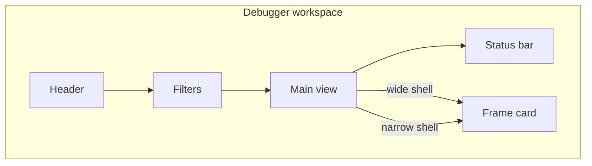

# Admin design

The admin is a Gantt-first debugger for one OTLP record stream. A person capturing or replaying that stream should see system status in words, filter the rows they care about, inspect one record without losing their place, and undo a destructive clear.



The frame card sits beside the main view when the shell is at least 680px wide and in a bottom drawer when it is narrower. That switch uses the shell width (`container: admin-shell`), not the viewport.

Local words: a record is one OTLP span or log row; the frame card is the inspector for the selected record; a chip is an on/off filter control.

## Required rules

These are required. Product journeys named in the admin refactor plan are how each rule is proved in the product. Kit stories under `src/stories/design-system` prove rule 4 for shared components, with Storybook accessibility violations treated as test errors.

1. Visibility of system status. Status is words, including how many records are waiting while paused, an in-progress row, and an "N new" count when live follow is off.
2. Match with the real world. Use Reatom words (action, atom, computed, LOG, abort), human-readable durations, and names as they appear in code.
3. User control and freedom. Clear can be undone, Escape closes the top admin layer, filters can be reset, and Back and Forward walk selection history. Selection survives mode and view changes.
4. Consistency and standards. Product UI is composed from this kit. Tables use grid semantics, view switches use tabs, and Escape behaves the same on every admin layer. Design-system component stories set Storybook `a11y.test` to `error`. The package preview default stays `todo` for product stories.
5. Error prevention. Filter-language errors show before apply. Clear is undoable. Escape inside the admin does not activate the host's shortcuts.
6. Recognition rather than recall. Chips show counts, the frame card shows causes, and shortcuts appear on the controls and in help.
7. Flexibility and efficiency. Keyboard use, saved filters, and an errors chip are available.
8. Aesthetic and minimalist design. One primary surface. Advanced filters start collapsed. Counters are not duplicated.
9. Help users recognize and recover from errors. An error row shows the message, the frame card leads with the error, and a denied remote source tells the person what to do.
10. Help and documentation. Help lists shortcuts and the filter language. An empty live session lists the setup checks.

## Setup choices

Saved for this connection:

- Migration mode is contracts only. Contracts, indexes, and this file describe the kit. The migration does not change the runtime of Button, DataGrid, EmptyState, Field, Icon, InspectorTabs, RailGraph, SplitPane, StatusBar, Tabs, or Toolbar.
- The migration area is `src/view/design-system`. Tokens in [`src/view/design-system/tokens.ts`](src/view/design-system/tokens.ts) and shared CSS in [`src/view/design-system/mixins.ts`](src/view/design-system/mixins.ts) are the token source, not UI contracts.
- Verification runs. Structural contract checks, index checks, typecheck when types move, and the design-system stories for new or restyled kit pieces all run.
- Craft after that migration adds only the entities the kit did not already cover: Drawer, Toast, Popover, Disclosure, Kbd, Inspector, the debugger-workspace layout, and the inspect-record, filter-records, and undoable-destructive-action patterns.
- `GanttChart` stays product UI in `src/view/otlp`. A row adapter supplies `renderRow` and an optional `toolbar`. Records and paths are the two consumers. It may compose kit components. It is not a kit entity.
- Inspector in [`src/view/inspector`](src/view/inspector/Inspector.tsx) is the contracted value tree. Other views outside `src/view/design-system` stay unmanaged. Later cleanup removes the legacy admin modules. This setup does not document those other views.

## Design-system sources

- Components: [index](design-system/COMPONENTS.md)
- Layouts: [index](design-system/LAYOUTS.md)
- Patterns: [index](design-system/PATTERNS.md)
- Tokens: [`src/view/design-system/tokens.ts`](src/view/design-system/tokens.ts). `tokens` and `railTokens` are colors and type roles. `space`, `radius`, `size`, and `type` are spacing, radius, control size, and type roles. `adminThemeVars` is the stylesheet preamble that defines the custom properties. The default sheet is the original dark violet. A picked accent calculates a light or dark palette from that hue, and the shell paints those variables. `soft` mixes a token with transparency. Do not introduce raw colors outside this file.
- RailGraph visual source: the layout and states in its [contract](design-system/components/rail-graph.md). The older [`railway-reference.jpg`](src/view/design-system/railway-reference.jpg) is history, not the target.
- Motion: `--admin-motion-hover`, `--admin-motion-select`, and `--admin-motion-overlay`. Any transition uses the `reducedMotion` mixin so `prefers-reduced-motion: reduce` removes it.

UI indexes route to contracts. Token files have no eligibility status.

## Contracts and public use

Component contracts live in `design-system/components/`, the layout in `design-system/layouts/`, and patterns in `design-system/patterns/`. Frontmatter paths are relative to `packages/admin`.

Product views in this package import the barrel [`src/view/design-system/index.ts`](src/view/design-system/index.ts). Inspector is imported from [`src/view/inspector`](src/view/inspector/index.ts). The kit is not a separate package entry. Overlay components render as descendants of the shell that mounts them, including when that shell is a shadow root. They do not portal to `document.body`.

Craft may change design-only CSS, markup, and public design settings of kit components. Filter logic, the Gantt, selection, and the live connection stay in `src/otlp` and `src/gantt`.

## Verification

From the repository root:

```sh
node skills/design-system/scripts/check-contract.mjs --kind <component|layout|pattern> --update-sources-hash <contract.md>
node skills/design-system/scripts/generate-indexes.mjs packages/admin
node skills/design-system/scripts/generate-indexes.mjs --check packages/admin
pnpm --filter @reatom/admin typecheck
pnpm --filter @reatom/admin exec vitest run --project=storybook src/stories/design-system/<story>.stories.tsx
```

Design-system component stories set `parameters.a11y.test` to `error`. Do not set that default in `.storybook/preview.ts`. Storybook interaction style is [`.storybook/README.md`](.storybook/README.md).

## Gaps and decisions

Open gaps: [journal](design-system/gaps.md). Closed entries move in full to `design-system/gaps-archive.md` with their disposition, closure date, and basis.

## Product boundaries

The Gantt UI composes this kit and keeps its own record, time-axis, and selection behavior.

- View switches for Timeline, State, Graph, and Analytics use Tabs. Timeline unit buttons are Waterfall, Log, and Paths. InspectorTabs is only the four sections of one record: Overview, Cause Chain, History, and JSON.
- Overview shows that record's state or payload, then its params, in one column and without headings. The value trees start expanded, including nested collections. Attributes, causes, effects, and resource are not on Overview. Analytics event logs (`app.*`, `session.*`) show event attributes on Overview (R26 G5). Cause Chain keeps the cause graph and Open in Graph.
- The wide frame card uses the debugger-workspace side pane, which is a SplitPane. Below 680px of shell width the same card is a Drawer. Do not use a viewport media query for that switch.
- Name search and value search use SearchField. On/off filters use Button `variant="ghost"` with `pressed`. Advanced filter options use Disclosure, collapsed by default. Reset uses Button without `pressed`.
- A destructive clear uses Button `variant="danger"`, then Toast with an undo action. The toast does not restore records itself.
- Structured hints, including drop reasons, use Popover. A single short phrase may use Button `title`. Shortcut chords outside SearchField use Kbd.
- Inspector shows one value as an expandable tree. The cause chain uses RailGraph. A uniform row table uses DataGrid. The waterfall stays in the product Gantt.
- `main` passed to DebuggerWorkspace is reparented when the card opens or the shell crosses 680px. `inspector` is called again in those cases. Keep both states in atoms.
- Escape inside a Drawer or Popover closes that layer. Escape in the wide shell closes the frame card unless focus is in a text field. The product returns focus to the selected row from `onInspectorClose` when the drawer did not already restore it.
