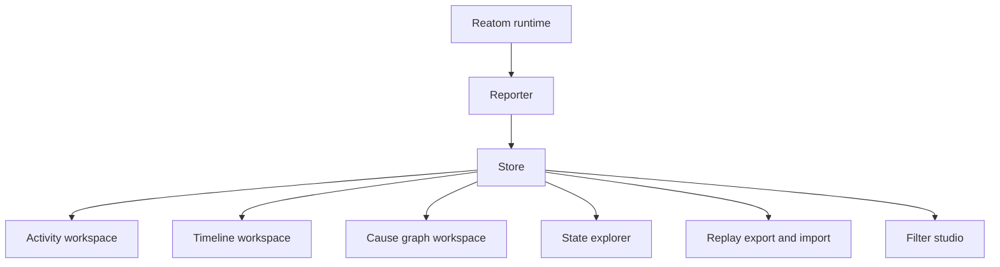

# @reatom/admin

Product-grade Reatom debugging workspace for live activity tracing and replay
analysis.

`@reatom/admin` turns the early tracing primitives in this repository into a
full investigation surface:

- live in-page devtools
- replayable exported sessions
- saved rules and reusable filter tags
- timeline analysis
- causal graph exploration
- state explorer and structured inspector panels

## What ships now



## Installation

```sh
npm install @reatom/admin
```

## Quick start

### Mount the full in-page devtools

```ts
import { createAdminDevtools } from '@reatom/admin'

const adminDevtools = createAdminDevtools({
  initVisibility: true,
  maxFrames: 20000,
  metadata: {
    app: 'checkout-web',
    environment: 'development',
  },
})
```

### Mount the admin application into your own host element

```ts
import { createAdminApp } from '@reatom/admin'

const target = document.getElementById('admin-root')!

const { admin, unmount } = createAdminApp(target, {
  maxFrames: 10000,
  metadata: {
    app: 'backoffice-console',
  },
})
```

## Core workflows

### 1. Live investigation

- open the **Activity** route
- search by atom name, state, params, or payload
- save reusable filter rules in the **Filter studio**
- inspect a frame to review:
  - structured state
  - payload / params
  - causal chain
  - recent history for the same atom

### 2. Replay analysis

- export a session from the header controls
- import it back as a replay
- continue working with the same:
  - activity feed
  - state explorer
  - timeline
  - causal graph

### 3. Filter curation

- create reusable **tags** from multiple predicates
- compose tags into nested **AND/OR** expressions
- save the result as a rule in one of four modes:
  - **show**
  - **hide**
  - **highlight**
  - **exclude**

## Product surfaces

### Activity workspace

- rich activity feed
- quick built-in filters
- structured inspector
- recent history view
- state explorer

### Timeline workspace

- bucket size controls
- zoom and offset controls
- focused bucket inspection
- jumps back into selected frames
- Paths unit: the median page sequence across consented sessions, aligned at a step

### Analytics view

- visitors, sessions, page views, engagement, bounce, and errors
- trend of session starts
- pages, entry pages, exit pages, and sources
- a row scopes those sessions or opens Paths

### Cause graph workspace

- ancestor / descendant / full traversal
- depth limiting
- shortest path exploration
- synchronized frame selection

### Filter studio

- reusable saved rules
- nested expression editor
- custom predicate builder
- built-in quick tags for:
  - error
  - action
  - reactive
  - async
  - reject
  - fulfill

## Public API

```ts
import { createAdmin, createAdminApp, createAdminDevtools } from '@reatom/admin'
```

### `createAdmin(options?)`

Creates the full admin runtime without mounting a UI.

Useful when you want to drive the product from your own host shell or tests.

### `createAdminApp(target, options?)`

Mounts the product shell into a specific DOM element.

### `connectAdmin(otel, options?)`

Feeds an in-page `@reatom/opentelemetry` instance into the OTLP admin. Call it
in the app frame and mount the view with `mountAdminView`.

- `localValues` (default `true`) is written to `otel.options.localValues` while
  connected and restored on `dispose()`. Admin records then carry the live
  params, payload, state and errors (`recordValues(record)`). The Activity
  preview, Overview, History, the State tree and search use them. The record
  JSON tab, the records download, JSON exports and MCP stay on the masked OTLP
  attributes.
- `connection.localValues` is a writable atom (`boolean | 'all'`) for a
  settings switch. Register a boolean atom created in `ADMIN_FRAME` with
  `registerLocalWorkOption` to show it in the Settings tab's Local work section.
  `examples/chat/src/devtools.ts` shows the wiring.
- Only the newest 5,000 records keep live values.
  `connection.localValuesTrimmed` turns `true` once older records fall back to
  masked attributes.
- Two Local work switches are registered while connected. "Warn about lost
  trace context" writes `options.warnContextLoss` (default: the instance value,
  or on when it is absent). "Split long traces" (default on) writes the
  connect-time `maxSpansPerTrace` / `maxTraceMs`, or `Infinity` for both when
  off.
- Both switches persist per user. A stored value wins over the instance at
  connect. `dispose()` restores the previous tracing options and unregisters
  the switches.
- `connection.warnContextLoss` and `connection.splitLongTraces` are writable
  boolean atoms. `tracingSettings: false` skips the switches and leaves those
  otel options untouched.

### `createAdminDevtools(options?)`

Creates the docked in-page devtools shell with a corner resize grip, minimize
in the toolbar (collapses to a floating pill), and show/hide capabilities. The
product chrome is a dense toolbar (brand, Live/Replay source, recording toggle,
session actions) with an inline metrics strip rather than oversized summary
cards.

## Built-in test strategy

The package is designed to be tested with realistic user scenarios. Storybook
interactions use [Kahraman](https://github.com/apphane-dev/kahraman) through the
project adapter in [`.storybook/helpers`](.storybook/helpers), with conventions
documented in [`.storybook/README.md`](.storybook/README.md).

- unit tests for the reporter, store, filters, timeline, and graph
- Kahraman-driven Storybook interaction stories that simulate real debugging
  journeys with real example applications
- high-level Storybook investigations that validate:
  - admin-first instrumentation setup
  - captured action and atom activity
  - replayable inspection flows
  - user-visible debugging workflows
- long-form gallery integration journeys (`Integration/Gallery`) that
  mix app curation (view modes, search, selection, favorites, lightbox) with
  admin Activity / Timeline / Graph / Filter studio inspection across 25–50
  sequential steps per story

## Development scripts

```sh
pnpm --filter @reatom/admin storybook
pnpm --filter @reatom/admin test:unit
pnpm --filter @reatom/admin test:stories
pnpm --filter @reatom/admin test:stories:smoke
pnpm --filter @reatom/admin test:stories:visual
pnpm --filter @reatom/admin test
```

## Multi-agent workflow

Parallel agent sessions coordinate through [`workflow/README.md`](workflow/README.md)
and [`workflow/backlog.yaml`](workflow/backlog.yaml). Every feature follows
Storybook e2e TDD with programmatic assertions and visual screenshot baselines.
