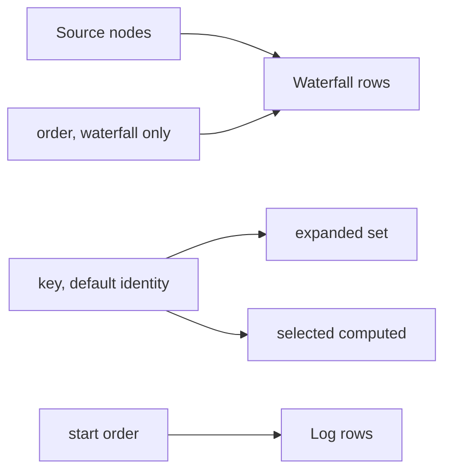

# Gantt keys and order

Started from R26 (analyst view). `reatomGantt` now takes an optional `key` and an optional `order`. Path rows use both. Record rows keep the previous identity and start order.

## Problem

Path nodes are rebuilt on every segment change. Expansion and selection were `Set<Node>` and `Atom<Node>`, so a filter change dropped the open path and the selected step.

Record rows do not have that problem: `AdminRecord` objects stay the same object until ingest replaces them. The in-progress placeholder and the landed span share a span id (`sourceId:traceId:spanId`) and must stay two rows until `adoptArrivedSpans` moves expansion and selection across.

Call sites today: one record Gantt in `reatomOtlpAdminModel`, plus unit tests. The path Gantt is the second consumer.

## Constraints

1. One Gantt draws both record waterfalls and path trees. A second tree component would duplicate the axis, virtual window, and keyboard model.
2. Omitting `key` keeps today's behavior, including a selection that still returns the stored node after it leaves the source.
3. Log mode stays in start order. `order` applies to waterfall roots and siblings.
4. `rowIndexAt` stays a binary search unless `order` is set in waterfall mode, where root rows are no longer sorted by start.

## Current tool

`reatomGantt` keyed expansion and selection by node identity and sorted siblings with `sortByStart`. That is the right default for records. It cannot keep a path step selected across a rebuild.

## Why it fails

Composition: the path tree already produces `id`, `parentId`, and a frequency order. Identity and start order ignore both, so the path view cannot reuse the Gantt as it is.

Explicit specifics: the thing that differs per consumer is the identity and the sibling order. Those were fixed inside the model.

## Directions

### 1. Memoize path node objects

Keep the same node object when its id is unchanged, so identity still works.

**Leaning:** rejected. Stats on the node change when the segment changes. Memoizing the object would show stale medians or force a mutation of a value the computed just returned.

### 2. Default `key` to `id`

**Leaning:** rejected. The in-progress synthetic record and the landed span share a span id. A default id key would make `adoptArrivedSpans` collapse them into one expanded row before the adopt step runs.

### 3. A separate path tree component

**Leaning:** rejected. It would copy the time axis, the virtual window, and the keyboard model.

### 4. Optional `key` and `order` on `reatomGantt`

```ts
const paths = reatomGantt(
  pathNodes,
  analyticsPathTiming,
  `${name}.paths`,
)
```

`analyticsPathTiming` sets `key` to `node.id` and `order` to `compareAnalyticsPathNodes`. Record timing omits both. `selected` is a computed: without `key` it returns the stored node; with `key` it returns `nodesByKey().get(keyOf(stored)) ?? null`. `nodesByKey` is built only when `key` is set, and only when `selected` is read.



## Decision

Ship direction 4. `Key` defaults to `Node`, so existing call sites keep `Gantt<Node>` and `ReadonlySet<Node>`.

## Implementation

- `expanded` stores keys. `expand`, `collapse`, `toggle`, `expandAll`, and `isExpanded` go through `keyOf`.
- Waterfall roots and siblings use `order` when it is set, otherwise start order. Log mode always uses start order.
- `rowIndexAt` scans root rows linearly when `order` is set and the mode is waterfall.
- Ingest no longer reads `gantt.expanded()`. It passes `inProgress().filter((record) => gantt.isExpanded(record))` into `adoptArrivedSpans`.

## Status

- Shipped: `key`, `order`, `analyticsPathTiming`.
- Removed: the direct `gantt.expanded()` read in ingest.
- Migrated and verified in: `reatomGantt.test.ts` (`keys and order`) and the existing identity selection test.
- Open bugs: none in this change.
- Follow-ups: the path chart is the analyst-view phase 1 consumer.
