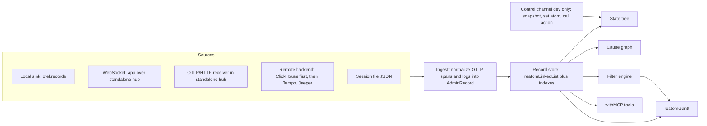

# 04 — `@reatom/admin` rewrite: an OTel-first dashboard

## Target (Д1, Д9, Д15)

Admin becomes an **OpenTelemetry dashboard that renders Reatom-specific data richer**. The same UI serves:

- the current app in dev, live, with state and editing
- a production backend, read-only through its query API (Д2, Д12)
- an exported session file

"Everything, for everyone, at once": the end goal is an incredibly rich, highly configurable dashboard where a million features can be switched on and it still works well. Reatom must keep it reliable and fast (Д15). Complexity hides behind smart filters: a simple search by default and a full calculator in an accordion (Д1, Д28). Any OTLP producer works. Reatom producers additionally get state trees, cause graphs, and frame cards.

The UI is built with `@reatom/jsx` (Д36).

## What exists today (≈ 16k lines)

`createAdmin()` runs inside `ADMIN_FRAME`, so it doesn't record itself. The Reporter is a global middleware that emits `AdminFrame { id, timestamp, sessionId, atomId, state, error, params, payload, pubIds }`. Workspaces: Activity (feed and inspector), Timeline (buckets, zoom), Cause graph (direction, depth, path, re-root), Filter studio (tags, nested AND/OR, show/hide/highlight/exclude, persisted), and Session export/import. There is a docked Shadow DOM shell (`DevtoolsShell.tsx`), a design system (`DataGrid`, `SplitPane`, `RailGraph`, tokens), and Storybook journeys with visual baselines driven by a multi-agent `workflow/`.

### Reuse matrix

| Module                                               | Decision                                                                                                                                 |
| ---------------------------------------------------- | ---------------------------------------------------------------------------------------------------------------------------------------- |
| `reporter/`                                          | Retired under option B (below). During migration it becomes an adapter that converts frames to records, so existing stories keep passing |
| `store/`                                             | Rewrite on `reatomLinkedList` with indexes                                                                                               |
| `filters/engine`, `expression`, `predicates`, `tags` | Keep the expression tree and modes. Add targets and a text parser for the calculator                                                     |
| `filters/search`, `persistence`                      | Keep. Saved rules stay in storage as today. New string-serialized filters are TODO (Д30)                                                 |
| `cause-graph/`                                       | Keep the traversal algorithms. Input comes from `reatom.cause.ids` plus links                                                            |
| `timeline/`                                          | Merged into the Gantt time axis (Д32). `utils` buckets feed a minimap                                                                    |
| `session/`                                           | Export/import format v2 (JSON, Д41), with a v1 importer                                                                                  |
| `view/screens`, `view/components`                    | Redesigned (see Design process)                                                                                                          |
| `view/design-system`                                 | Kept as raw material. Tokens and visuals are redone after the design debate                                                              |
| `stories/`, `testing/`, `workflow/`                  | Kept, extended with new journeys                                                                                                         |

### Reporter versus OTel records (Д10, Д13)

- **Option A — two pipelines.** Keep the Reporter for dev and correlate its frames with spans through a shared `reatom.frame.id`. This means double interception overhead, two schemas, and an admin that differs between dev and prod.
- **Option B — OTel-first (recommended).** The tracer instance is the only in-app recorder. In dev it runs with `endpoint: null` or next to a real endpoint (`connectAdmin` turns on `keepRecords`), and its `records` sink feeds admin directly. Admin's clear buttons call `otel.clearRecords()`. Because `detail` and capture settings now decide what admin sees, `connectAdmin` may raise them locally in dev; it never changes what production exports. A "frame" in admin _is_ a record: spans for actions, `reatom.*.update` logs for atoms and computeds, with `reatom.frame.id` and `reatom.cause.ids` rebuilding the cause graph ([05](05-telemetry-schema.md)). The result is one schema for dev, prod and agents, and admin also works for non-Reatom OTel apps. What the tracer must guarantee for this: under `detail: 'events'` it records every non-private atom update, including those outside actions, with state bodies. Live state that has not changed since connect comes from the control channel, not from records.

Step AD-1 is a deep analysis of the existing package that validates option B against every current story. It lists anything the Reporter shows that records would not.

## Data layer (inside `ADMIN_FRAME`)



- `AdminRecord` is a normalized span or log: `{ id, sourceId, kind: 'span' | 'log', traceId, spanId, parentSpanId, name, start, end?, attributes, body?, resource, links }`, plus derived fields (`reatomKind`, `frameId`, `causeIds`, `atomName`).
- **Store:** records live in `reatomLinkedList` so future virtualization applies (Д1, Д37). Indexes are by trace, span, frame id, name, and atom name. Aggregates (spans per trace, errors, updates per span) are computed at ingest, not per render.
- **Retention (Д11):** keep everything and survive nothing across reload. Explicit **Clear source**, **Clear all**, and **Drop older than…** buttons that actually free memory (verified by a test holding no references).
- **Performance (Д37):** no virtualization now. The target is ~100k records usable: ingest batched per animation frame, and only expanded subtrees rendered. A Storybook perf story with 100k synthetic records is the gate.

## `reatomGantt` (Д1, Д3, Д24, Д25)

`reatomGantt` is a headless model over `reatomLinkedList`, living in `admin/src/gantt` first (open question 6). Its state:

- **Rows:** a hierarchical tree of spans, with log records either as markers on their span row or, in log mode, as child rows. Expand and collapse per row and per level.
- **Time axis:** range, zoom, offset, and a cursor. Absorbs today's Timeline.
- **Columns:** a configurable set with visibility, order, and width (Д3).
- **Selection:** the selected row, keyboard focus, and multi-select for compare-free bulk actions (copy, export selection).
- **Grouping:** by trace, session, route, or source, with badge counters (Д15).
- **Modes:** `waterfall` (Network-like, Д25) and `log` (flat by time with optional indentation). The owner leans toward **only the Gantt, good enough to work as a logger** (Д3). There is no separate flat logger unless the design debate proves the Gantt log mode insufficient.

It is fully testable without the DOM. Views subscribe to it. A `key` identifies expanded and selected rows when the source rebuilds node objects, and an `order` sorts waterfall roots and siblings. Log mode stays in start order. The default key is the node itself.

## Views

### Gantt view

A proposal for Д14, which was not answered.

- **Collapsed row:** kind icon; normalized name with the instance id muted; duration bar on the time axis; badges for errors, update count, child spans, cross-trace links, and low importance (abort, Suspense); one key attribute (route, `http.response.status_code`, or the first user attribute).
- **Expanded row:** an inline frame card (below).
- Abort and Suspense rows are hidden by a default quick filter that can be toggled (Т25). `_`-private targets are never recorded at all (Т30), so there is nothing to hide; the only exceptions are the system kinds the tracer handles internally (render, mount, route).
- The number of spans in a trace is a visible column and a filter target: it is how a real scenario is told apart from a lone loader firing, and Maple lacked it at the time (Vlad); Maple shows the span count since Aug 2026.
- `LOG` rows are highlighted (Т29).
- Stats of the instance (`otel.stats`) show in the status bar.

### Frame card (Д20)

The most relevant data comes first, without overloading:

1. name, kind, outcome, duration
2. error (type, message, stack, async cause chain)
3. Overview: state or payload, then params, in one column without headings. Each JSON tree starts expanded
4. Cause Chain, History (previous state of the same atom), and JSON for the rest of the record

Attributes, causes, effects, and resource are not on Overview. Cause Chain lists causes and offers Open in Graph. The JSON tab holds the record, including attributes and resource.

### State tree (Д16–Д18)

- The tree comes from dot-separated names (the naming convention, О20). Parsing rules are borrowed from Reatom v3 devtools. Atoms outside the convention go into an "other" group, and `#id` instances are grouped under their factory.
- In dev the values are **live** through the control channel's snapshot subscription (Д17). In replay or prod they are the last recorded state.
- **Editing (Д18):** set an atom value (JSON editor) and call an action with params. Both go through the control channel, which runs them inside `otel.attributesVar.run({ 'reatom.origin': 'admin' }, …)`, so the resulting records get `reatom.origin = 'admin'`.
- No time travel (Д19).

### Cause graph and diamonds (Д21)

The Gantt shows sequence, but not multi-cause diamonds of computeds. Research R13 checks how Jaeger, Tempo, SigNoz and Grafana render span links (the expectation is a list of references, no DAG). The proposal:

- The frame card's **Cause Chain** tab lists every cause, and Open in Graph selects the graph view.
- The cause graph view renders a DAG with lanes per trace (reusing `RailGraph`/`rail-layout`). Cross-trace edges are dashed, cycles cannot occur (the records are a sequence), and depth, direction and re-root carry over from today.

### Navigation (Д22, Д23)

- Back and forward buttons over a selection history atom (Alt+← / Alt+→). No cascade panels or breadcrumbs.
- **Open in editor:** the tracer's dev-only option `captureCodeLocation` records `code.file.path` / `code.line.number` once per target, at creation, from the stack. Admin opens `cursor://file/…`, `vscode://file/…` or a configurable scheme.

### Paths unit (R26)

The Timeline's third unit, beside Waterfall and Log. The same `reatomGantt` draws page sequences merged across consented sessions. Bars sit at the median offset from the alignment point, and the step card opens the sessions behind a step or one typical session. See [R26](notes/R26-analyst-view.md).

### Analytics tab (R26)

A fixed tab of totals, a session trend, and breakdowns for pages, entry pages, exit pages, and sources. A row sets a removable session scope. Paths and Analytics treat the filter as a session filter: a session is in when any of its records match, and Exclude flips that. See [R26](notes/R26-analyst-view.md).

### Other views (Д24, Д31, Д32)

Timeline and the Filter studio are folded into the Gantt and the filter panel (Д32). An error list grouped by `exception.type + message` and a web-vitals panel are candidates. R19 decides after the Gantt is usable, and the owner answered "don't know" (Д31). R26 answers part of Д31: totals, breakdowns, and paths for analytics records.

## Filters (Д1, Д26, Д28–Д30)

- **Default:** two search boxes. One searches by name (glob), the other inside payload, params and state (full text over serialized values).
- **Accordion "calculator":** an expression with `AND`, `OR`, `NOT` and parentheses, with token highlighting, applied with a mode (show, hide, highlight, exclude). Example:

  ```text
  name:checkout.* AND (state:"out of stock" OR NOT params:guest) AND duration>100ms AND attr.http.response.status_code>=500
  ```

- **Targets:** `name`, `params`, `payload`, `state`, `attr.<path>` (nested paths), `event`, `kind`, `outcome`, `duration`, `spans` (per trace), `errors`, `trace`, `session`, `route`, `source`, `cause>`/`cause<` (from today's cause predicate).
- The syntax is decided by R15 ("do it properly", Д26): SQL-like versus this simple form, plus a possible drag-and-drop builder. The parser outputs today's `FilterGroup` tree, so the engine is reused.
- Filters are **shared by all views** (Д29) and are the same language the MCP tools accept, for agent parity (О1).
- Saving filters as a string is TODO (Д30).

## Sources, hosts and connection

### Connection is runtime-only (Д6)

```ts
// setup.ts, dev only
import { connectAdmin } from '@reatom/admin'
import { otel } from './otel'

connectAdmin(otel, { host: 'widget' })
connectAdmin(otel, { host: 'pip' })
connectAdmin(otel, { url: 'ws://127.0.0.1:7531/?token=…' })
```

No Vite, Metro, Webpack or Next plugins.

### Hosts (Д4)

1. **Widget:** mounted into the page through Shadow DOM (today's `DevtoolsShell`), docked and resizable.
2. **Popout:** the same UI moved into a Document Picture-in-Picture window ([14] in README), with a fallback to `window.open` where it is unsupported.
3. **Standalone app:** `npx @reatom/admin`. This is a runtime process, not build tooling. It serves the UI, a WebSocket hub, and an **OTLP/HTTP receiver** (`/v1/traces`, `/v1/logs`) on `127.0.0.1`. React Native, SSR on Node, and any OTLP producer can point `endpoint` at it, and a Reatom app additionally connects the control channel over WebSocket. The channel for React Native is research R17 (the owner said to think about it; WebSocket is the default candidate).
4. **Later:** Chrome and VS Code extensions (Д4).

### Tabs (Д8)

Every connected app, tab, or remote query is a source tab. A merged view across sources is available.

### Channel security (Д7, "do it properly")

- Bind to `127.0.0.1` only.
- A random token printed on start and required in the WebSocket URL and OTLP header.
- An `Origin` allowlist (by default the origins that presented the token).
- No remote exposure. Write access (edit, call) is refused unless the app opted in with `connectAdmin(otel, { control: true })`, which defaults to true in dev and must be set explicitly otherwise.
- R16 reviews this.

### Remote backends (Д2, Д12, Д43)

- The first adapter is **ClickHouse** (the OTel collector exporter tables for traces and logs, over the HTTP interface), matching the test backend choice (О16). Tempo (TraceQL) and Jaeger query come later (R20).
- Queries: by trace id, and by time range plus filters. The calculator is translated to SQL where possible, otherwise fetched and filtered locally, with a visible "filtered locally" badge.
- **Credentials (Д43):** login/password or bearer token, held in memory for the session (nothing survives reload, Д11). Passed as headers, or through the standalone hub as a proxy when the backend does not allow CORS. The hub never logs credentials.
- Admin never connects into a production user's live session (Д2).

### Control protocol (dev)

JSON messages over WebSocket, or a direct in-page call for the widget:

| `type`                            | Direction   | Content                                                                         |
| --------------------------------- | ----------- | ------------------------------------------------------------------------------- |
| `hello`                           | app → admin | protocol version, `service.name`, `service.instance.id`, platform, capabilities |
| `records`                         | app → admin | a batch of OTLP JSON (spans and logs), when not sent over OTLP/HTTP             |
| `snapshot.subscribe` / `snapshot` | admin ↔ app | atom values by name prefix, serialized with the tracer's serializer             |
| `atom.set`                        | admin → app | name, JSON value                                                                |
| `action.call`                     | admin → app | name, JSON params                                                               |
| `ack`                             | both        | sequence numbers. The app buffers unacknowledged batches in a bounded ring      |

Batches are sent at most every 100 ms and at most 256 KB each.

## MCP (Д33, Д34, О1)

The admin model is extended with `withMCP` ([12] in README) on its atoms and actions. That includes actions, so agents can do more than read. Tools, each accepting the calculator filter language:

| Tool                                                                            | Returns                                                                                                    |
| ------------------------------------------------------------------------------- | ---------------------------------------------------------------------------------------------------------- |
| `admin.summary`                                                                 | Sources, counts by trace, name and error, the time range                                                   |
| `admin.listTraces({ filter, page, pageSize })`                                  | Root name, duration, span count, error count, route, and a cursor                                          |
| `admin.getTrace({ traceId, depth, cursor })`                                    | A summarized span tree with truncated values and child counts. Deeper pages via cursor                     |
| `admin.search({ filter, cursor })`                                              | Matching records, summarized                                                                               |
| `admin.analyticsSummary({ filter, segment, range, limit })`                     | Totals, a UTC session trend, and breakdown rows. `filter.mode` is ignored; `segment` is include or exclude |
| `admin.paths({ filter, segment, range, align, maxDepth, maxChildren, cursor })` | Summarized path nodes. `maxDepth` is 1–20 and `maxChildren` is 1–50. `filter.mode` is ignored              |
| `admin.getRecord({ id })`                                                       | The full record, with cause ids resolved to names                                                          |
| `admin.getState({ path })`                                                      | A subtree of the state tree                                                                                |
| `admin.setAtom`, `admin.callAction`                                             | Dev control, same permissions as the UI                                                                    |
| `admin.clear`, `admin.selectSource`, `admin.connectRemote`                      | Housekeeping                                                                                               |

Every response is capped (default 20 KB), with `nextCursor` and a summary header, so a large trace never floods the agent's context (Д34). Custom attributes (`reatom.*`, `app.*`) are always included; the Maple MCP lacked this, which made it useless (Vlad). As of Maple HEAD 2026-10 its MCP returns custom attributes, but only in the cloud, not in local mode.

WebMCP reaches browser agents only. For CLI agents the standalone hub bridges the same registry to a stdio MCP server (open question 7). AI features inside the admin UI are next quarter (Д35).

## Export (Д41, Д42)

Export is JSON v2: normalized records plus source metadata, with a v1 importer. Sharing by link or upload is next quarter.

## Design process (Д3, Д38–Д40)

1. **Research R14:** Evil Martians' devtools design guides and their devtools work, plus the Chrome Network panel for density. Reatom v3 devtools is the reference for _functionality_, not visuals ("functionality great, visuals awful").
2. **Debate:** two or three designer agents on different models propose the Gantt, frame card and filter panel in `spec/notes/admin-design-*.md`. A third agent critiques, and the orchestrator picks.
3. **Implementation in Storybook:** the designer agent implements, screenshots through visual tests, self-reviews against the brief, and iterates. No mockups beforehand (Д40).
4. **Accessibility now:** basic keyboard navigation (focus order, arrows in the Gantt, Enter to expand, Esc to close).
5. **Hotkeys epic at the end:** a full shortcut map and a help page (Д38).

## Implementation steps

| ID    | Step                                                                                                            | Depends on                                     | Acceptance                                                                                                                 |
| ----- | --------------------------------------------------------------------------------------------------------------- | ---------------------------------------------- | -------------------------------------------------------------------------------------------------------------------------- |
| AD-1  | Deep analysis of the existing admin against option B (Д10, Д13)                                                 | —                                              | `spec/notes/AD-1-admin-analysis.md` maps every current capability to a record-based equivalent, or to a gap for the tracer |
| AD-2  | `AdminRecord`, OTLP ingest, linked-list store, indexes, clear buttons; fixtures recorded from the v2 tracer     | P3 schema freeze                               | Ingest of the e2e scenario reproduces spans, logs and cause ids                                                            |
| AD-3  | `reatomGantt` headless model                                                                                    | AD-2                                           | Tree, axis, columns, grouping, modes, keyboard model covered by unit tests                                                 |
| AD-4  | Filters: two searches, calculator parser to `FilterGroup`, new targets, shared by views                         | AD-2; informed by R15                          | Parser round-trips. Engine tests pass for new targets                                                                      |
| AD-5  | Sources: local sink, file import/export v2, WebSocket client, standalone hub with OTLP receiver and token       | AD-2; informed by R16                          | A React Native-style Node client sends records through the hub. Wrong token rejected                                       |
| AD-6  | Control channel: snapshot subscription, live state, `atom.set`, `action.call`                                   | AD-5                                           | Edits produce records with `reatom.origin = admin`                                                                         |
| AD-7  | MCP tools with pagination and caps + the stdio bridge in the hub                                                | AD-4, AD-6                                     | Agent journey test: find the failing trace of a scenario through tools only                                                |
| AD-8  | Remote ClickHouse source with credentials                                                                       | AD-4; informed by R20                          | The e2e ClickHouse data opens in admin                                                                                     |
| AD-9  | Hosts: widget, PiP popout, standalone UI                                                                        | AD-5                                           | Storybook journeys in each host                                                                                            |
| AD-10 | Design debate, then views: Gantt, frame card, state tree, cause graph with diamonds, navigation, open in editor | AD-3, AD-6, R14 (no fallback); informed by R13 | Visual baselines committed. Journeys from `stories/gallery` and `reatom-jsx-xo` ported                                     |
| AD-11 | Perf gate: 100k records                                                                                         | AD-10                                          | Interaction stays responsive (expand, filter, scroll) within agreed budgets                                                |
| AD-12 | a11y baseline; later the hotkeys epic                                                                           | AD-10                                          | Storybook a11y addon in CI (existing backlog task `a11y-enforcement`)                                                      |
| AD-13 | Docs: connect in `setup.ts`, hosts, standalone for React Native, remote backends, MCP guide                     | all                                            | Docs-site pages                                                                                                            |
| AD-14 | R26 phase 1 analyst views: totals, breakdowns, Paths, session scope, G4, G5, MCP                                | AD-3, AD-4                                     | Unit tests, MCP cap, and Storybook smoke journeys for the Analytics tab and the Paths unit                                 |
| AD-15 | R26 phase 2: ClickHouse range, SQL totals, sampled paths, badges, grouped by session (G6, Д15)                  | AD-14                                          | Range query, exact totals, sample badges, and a session-grouped waterfall                                                  |
| AD-16 | R26 phase 3: funnels, whiskers, step drivers                                                                    | AD-14                                          | Funnel over the segment, p25–p75 whiskers, and a step-versus-all comparison                                                |

Update `packages/admin/workflow/backlog.yaml` with these IDs, and rewrite `TSD.md` after AD-1.

## Not now, and never

Chrome/VS Code extensions, AI features, session sharing, virtualization, string-saved filters, and surviving reload all come later. Time travel and side-by-side trace compare are never. No build tooling.
