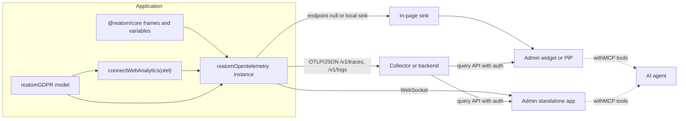
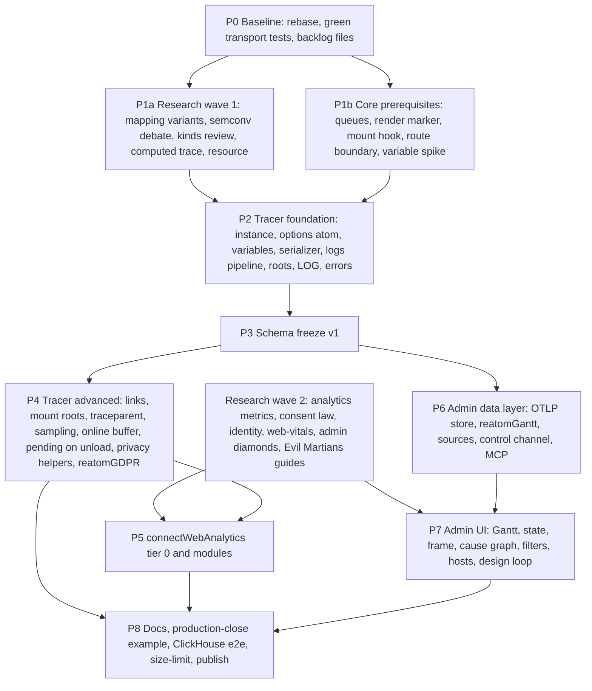

# Implementation plan: `@reatom/opentelemetry` v2, `connectWebAnalytics`, `@reatom/admin` rewrite

- Date: 2026-09-28. Updated 2026-10-07: merged production feedback, talk rehearsals, the SRE review, the earlier drafts doc 10 and doc 11, and a line-by-line re-check of every О, Т and А answer. This folder is the single source of truth for the three packages. Anything found elsewhere and missing here is added here.
- Baseline: `v1001` at `29c477d4` (PR #1274 merged, not on npm). Rebase onto `origin/v1001` first: `56c86f24` adds `visibilityAtom` (#1365), which analytics needs.
- Nothing here is published yet, so breaking API changes are free.
- Implementer: artalar with an agent team. Credits in docs and the talk: Dmitry Sinev (**astartsky**) for the tracer, Vladislav for the `examples/opentelemetry` prototype and its production use.

## Why

Reatom's async context already knows which action caused which update, with no patching of globals. Devtools, web analytics and monitoring all turn out to be the same job: collecting logs. So one OpenTelemetry-native stack on Reatom primitives should be the most universal, simplest and most efficient option all at once. The end goal is to sell Reatom by building a genuinely good solution, not by pushing it.

There is no single killer feature; the selling point is universality (О2). An app on Reatom with the Reatom logger should be, on average, faster, lighter in bundle and cheaper to maintain than the same app with a separate stack (О2, О3). Tracing is nearly free because it is a by-product of data structures Reatom already keeps for reactivity (Run2). Replacing Sentry-style error monitoring, loggers and devtools stays the goal of the stack as a whole; only the GA and Metrika part was scoped down to a light analytics base (О3, А1).

### Users and use cases (О1)

- **Users:** first the developer, with or without Reatom in the app; then QA, second- and third-line support, analysts, managers and the on-call SRE; and the agent. Two things started the effort, and both are true: building devtools that display the async context turned out to be the same job as displaying OTel logs (the talk brief), and the agent needs convenient access to logs (О1).
- **The debugging loop to support end to end:** a bug arrives from production → get its production logs → reproduce in dev → get the dev logs → compare. Humans do it in admin, agents through MCP.
- **Use cases, all of which must work** (owner's comments on usage scenarios):
  1. The whole app is on Reatom.
  2. Partial integration: Reatom in part of an app on React, Vue or another framework (doc 10).
  3. Only admin, as a powerful filter over the OTel logs of any app.
  4. Only `connectWebAnalytics`, as light web analytics without Reatom in the app code.
  5. Reusable widgets on Reatom that other companies embed into their React, Vue or Reatom apps, each with its own collector. Such users exist today.

### Principles

These principles apply to every document in this folder:

1. **Smart defaults.** Everything works well without configuration, and every default can be tuned on top of itself or replaced entirely. Where the owner answered "don't know / figure it out / best practices", the spec ships a researched default plus full configurability, never a question back.
2. **More traces, not fewer.** Detailed traces plus a good filtering UI beat sparse traces. Trace every route by default, and probably every component mount. The usual feedback is "too many traces, don't start them automatically"; the stack must prove the opposite. A single loader trace can be the only way to see load order, for example when a non-idempotent `GET` answers differently depending on which loader started first (Vlad). What breaks a stack is not the gigabyte but an endless trace, a high-cardinality label and the lack of tail sampling (SRE); a corporate Jaeger choked on volume and took 30 s per query (Run2). Hence watersheds, nothing high-cardinality in index labels, and tail sampling in the recommended collector setup.
3. **Rely on Reatom's frame context.** The adapter reads existing frames and variables and never builds its own context model. Any core change needs owner approval.
4. **Reatom ecosystem first.** Heavy features (offline buffer, polyfills, monkeypatching) are opt-in extensions or lazily loaded modules, never defaults (Т43, О4).
5. **The agent is a first-class user.** Whatever filters a human can build in admin, an agent can run through MCP, and it can act, not only read (О1). Domain attributes must reach the agent: the Maple MCP hid custom attributes and became useless for debugging a Reatom app (Vlad). As of Maple HEAD 2026-10 its MCP returns custom attributes, but only in the cloud, not in local mode.
6. **Runtime only.** No bundler, Metro or framework plugins for any of the three packages (Д6).
7. **Do everything, with explicit deferrals.** "We have an army of agents" (Д5); what is postponed is listed in "Deferred and never" below.
8. **Primitives, not protocols.** Every public API follows the `reatom-api-design` skill (`.cursor/skills/reatom-api-design/SKILL.md`) and its Zen list: primitives outperform frameworks, composition beats configuration, explicit specifics and implicit generics, compatibility worth complexity, easy to use and hard to misuse, hardest solved and rest resolved. In practice: each public unit is an atom, an action, a variable, an extension or a plain value; values are emitted for native code (`traceparent()` returns a string), user code is not wrapped; a name is written once, at a definition; every forgotten step or misspelling ends in a type error or a dev warning, never in silence; global registries are namespaced and shared across package copies; nothing configures state it does not own.

## Requirement sources, by priority

1. Owner decisions. When two decisions conflict, the later one wins.
2. Practitioner feedback: production experience with `examples/opentelemetry` (Vladislav), questions from the two talk rehearsals, and the SRE review of the talk plan.
3. v1 code at `29c477d4` and the `connectWebAnalytics` prototype.
4. Earlier drafts (doc 10, doc 11), only where nothing above overrides them.

References like `Т42`, `А9`, `Д21` and `О12` are owner requirement IDs. The letters are Cyrillic: О = general, Т = tracer, А = analytics, Д = admin. Other source labels:

- **Vlad** — the conversation with Vladislav, author of the `examples/opentelemetry` prototype and its first production user.
- **Run1**, **Run2** — talk rehearsals on 2026-08-26 and 2026-09-24, with questions from Viktor and Ivan.
- **SRE** — the on-call SRE's review of the talk plan.
- **doc 10**, **doc 11** — the earlier Russian drafts of the tracer and analytics specs, superseded by this folder.
- **#1271**, **#1272** — the original issues.

This folder restates every decision it relies on and is self-contained.

## Baseline numbers

Measured on the owner's bench (`otel-bench/` in the owner's notes, outside this repo: `size.mjs`, `entries/`, `prototype/`, `e2e/`). Moving the bench into `packages/opentelemetry/bench/` is part of P0.

| What                                                    | Value                                                                                                                         |
| ------------------------------------------------------- | ----------------------------------------------------------------------------------------------------------------------------- |
| `connectWebAnalytics` prototype with web-vitals, brotli | 11.3 KB                                                                                                                       |
| Tracer + analytics, brotli                              | 15.8 KB                                                                                                                       |
| The same when the app already ships Reatom              | 12.4 KB                                                                                                                       |
| Analytics with web-vitals on top of the tracer          | 4.7 KB                                                                                                                        |
| Faro core / Faro with tracing, for comparison           | 35.2 KB / 71.3 KB                                                                                                             |
| Tracer logic / analytics prototype logic                | ~2000 / ~400 lines                                                                                                            |
| e2e scenario through the official collector 0.161.0     | 14 events, 10 spans, ~13 KB of traffic, one trace `checkout.submit` → `api.createOrder` → `POST /api/order` → `INSERT orders` |

The 15.8 KB include the queue, retries, the unload budget and the session. They do not include consent (the prototype has none), screen recording, sourcemap upload, sampling or error grouping.

What the prototype already does and v2 must keep: the principle of an explicit `traceparent` header with no global `fetch` patch, where a networked action is marked `withOTel({ kind: 'client' })`; query string and fragment dropped by default, UTM moved to `app.utm.*`, the full URL only with `captureQuery: true`; the `stats().dropped` counter as the loss signal.

What the prototype does wrong and v2 redoes: the free function `traceparent(otel.getCurrentContext())` used in the prototype and the e2e bench. The correct form is the instance method `otel.traceparent()` (owner decision 2026-10-07).

## Documents

| File                                                         | Contents                                                                                                                                                            |
| ------------------------------------------------------------ | ------------------------------------------------------------------------------------------------------------------------------------------------------------------- |
| [01-core-prerequisites.md](01-core-prerequisites.md)         | Changes to `@reatom/core` the three packages depend on: queues, render marker, Navigation API for `urlAtom`, route trace boundaries, the variable-propagation spike |
| [02-opentelemetry-refactor.md](02-opentelemetry-refactor.md) | Tracer v2: instance model, context on variables, trace roots, frame→OTel mapping, values, transport, sampling, privacy, a file-by-file plan, tests                  |
| [03-connect-web-analytics.md](03-connect-web-analytics.md)   | A ~3 KB automatic analytics layer on top of an instance: events, consent, identity, attribution, budget tiers                                                       |
| [04-admin-rewrite.md](04-admin-rewrite.md)                   | OTel-first admin: data layer, `reatomGantt`, sources and hosts, views, filters, MCP, design process                                                                 |
| [05-telemetry-schema.md](05-telemetry-schema.md)             | **The contract** between the three packages: span and log names, `reatom.*` and `app.*` attributes, cause ids                                                       |
| [06-research-backlog.md](06-research-backlog.md)             | Every "don't know / figure it out / research" answer, as agent tasks with a fallback default                                                                        |

## Decisions that override earlier drafts

| Topic                               | Earlier (v1 code, earlier drafts)                                                                               | Now                                                                                                                                                                                                                                                                                                                                                                                        | Source                    |
| ----------------------------------- | --------------------------------------------------------------------------------------------------------------- | ------------------------------------------------------------------------------------------------------------------------------------------------------------------------------------------------------------------------------------------------------------------------------------------------------------------------------------------------------------------------------------------ | ------------------------- |
| Default instance                    | Global singleton, `withOTel` imported from the package                                                          | No default instance. The user creates `reatomOpentelemetry` in `setup.ts` and gets `withOTel` from it. Creating it registers the global extension, and a factory option turns that off                                                                                                                                                                                                     | Т42 over Т35              |
| Endpoint                            | Required string                                                                                                 | Required key, `string \| null`. `null` means devtools-only (admin, tests, in-memory)                                                                                                                                                                                                                                                                                                       | Т42                       |
| Options                             | Construction-time only                                                                                          | `options` is an updatable atom on the instance                                                                                                                                                                                                                                                                                                                                             | Т47                       |
| Values                              | Not captured unless `captureValues: {}`                                                                         | Captured by default (params, payload, state) with a safe serializer, default redaction of sensitive keys, and a dev-time name checker                                                                                                                                                                                                                                                      | Т20, О17, О19             |
| Filter                              | `filter(target) => boolean`                                                                                     | Two hooks: `filter(target) => boolean` before applying, `extend(target, withOTel) => target` after                                                                                                                                                                                                                                                                                         | Т31                       |
| Repeated `withOTel`                 | `Object.assign`                                                                                                 | Flat options, merged key by key, skipping `undefined` values, last write wins                                                                                                                                                                                                                                                                                                              | Т32                       |
| Span events                         | Used for `exception`                                                                                            | Deprecated by OTel ([1]). Atom updates, `LOG` and exceptions become OTLP log records with span context                                                                                                                                                                                                                                                                                     | Т10, Т27                  |
| `LOG` outside a trace               | Would be a span                                                                                                 | A log record attached to the default app-session trace. Never dropped                                                                                                                                                                                                                                                                                                                      | Т28                       |
| Offline buffer                      | IndexedDB                                                                                                       | An online buffer on `onLineAtom`. Offline persistence is a user extension on the queue atom                                                                                                                                                                                                                                                                                                | Т43                       |
| Analytics scope                     | Fully replace GA and Metrika                                                                                    | A light, Plausible-style base of about 3 KB brotli. Everything else is opt-in modules. Focus is on SRE, with no custom BI dashboards for 6–12 months. The admin has fixed analyst views (totals, breakdowns, paths) over the same records; custom dashboards stay deferred (А2, owner 2026-10-16). Replacing Sentry-style errors, loggers and devtools remains the goal of the whole stack | А1, А2 over О3            |
| Context API                         | `getCurrentContext`, `withContext`, `withStartTrace` (v1, doc 10), a root marker in earlier drafts of this spec | `traceVar.get()`, `traceVar.run()`. A trace starts where there is none; a manual start is `traceVar.set(otel.createTrace())`, with no wrapper and no root marker. The prototype's `traceparent(otel.getCurrentContext())` becomes `otel.traceparent()`                                                                                                                                     | Т2, Т34, owner 2026-10-07 |
| Business events and manual tracking | Business events (signup, purchase) inside `connectWebAnalytics` (#1272); `trackEvent`, `withEvent` (doc 11)     | No manual API in analytics. Business events are ordinary traced actions, and any manual event is an action declared with `withOTel` of the tracer instance the analytics lives on, which analytics accepts or creates and returns. There is no `record(eventName)` method                                                                                                                  | А9, owner 2026-10-07      |
| Analytics navigation                | Navigation API only, `urlAtom` rejected for intercepting clicks (doc 11); `urlAtom` only (earlier draft of 03)  | A configurable source: read-only `urlAtom` without back-sync, the Navigation API, or `popstate` plus manual `pageView()`. Read-only is two existing `urlAtom` settings the app owns (`catchLinks`, `sync`); analytics never writes them and warns in dev when they are missing                                                                                                             | А6, owner 2026-10-07      |
| Analytics error events              | Optional (#1272)                                                                                                | `window.onerror` and `unhandledrejection` are mandatory                                                                                                                                                                                                                                                                                                                                    | А29                       |
| Trace boundary on routes            | `otel.withTraceBoundary(false)` as a separate extension (earlier draft of this spec)                            | A flat `withOTel({ boundary: false })` option, merged like the others                                                                                                                                                                                                                                                                                                                      | `reatom-api-design`       |
| Core singletons                     | Instrumented by the global extension (implicit in earlier drafts)                                               | `log`, `urlAtom`, `onLineAtom`, `visibilityAtom` exist before `setup.ts`, so the instance registry hooks them once explicitly                                                                                                                                                                                                                                                              | core code                 |
| Parent of a cross-trace computed    | The call-stack parent, other causes as links (doc 10)                                                           | The primary cause: the chain whose change triggered the recompute. Old unchanged chains become links                                                                                                                                                                                                                                                                                       | Т14                       |
| Computed without a trace            | —                                                                                                               | A computed never starts a trace and never creates a trace id. If the variable is found, it is used                                                                                                                                                                                                                                                                                         | Т34                       |
| Query string in analytics           | Opt-in `captureQuery` (doc 11) / always forbidden (earlier draft of 03)                                         | Off by default. UTM and click ids are always extracted. `captureQuery: true` records the full URL, as in the prototype                                                                                                                                                                                                                                                                     | А19, prototype            |
| Analytics before consent            | Nothing is stored and nothing is sent (doc 11, and the same phrase in the owner's notes)                        | Everything legally safe is collected and sent: aggregate-safe events with no identifiers and no storage writes. Engagement keeps counting in memory. The rest switches on with the `reatomGDPR` form. R11 (А19) draws the boundary                                                                                                                                                         | А18, owner 2026-10-07     |
| Values and error details            | `captureValues: false` (doc 10), `captureErrorDetails: false` (doc 11)                                          | The tracer captures values by default, with masking and the dev name check (Т20, О19). Analytics keeps error message and stack off by default (`captureErrorDetails: false`), because it must "be more careful" (О19)                                                                                                                                                                      | Т20, О19                  |
| Admin data source                   | Reporter feeds admin independently of what goes to OTLP (doc 10)                                                | Pending open question 8. Under option B the tracer's `detail` and capture settings also decide what admin sees, so admin's `connectAdmin` raises them locally                                                                                                                                                                                                                              | Д10, Д13                  |
| Unload budget                       | 64 KiB in the earlier draft of this spec                                                                        | 60 KiB per page, as in the v1 code: headroom under the browser's 64 KiB keepalive limit                                                                                                                                                                                                                                                                                                    | v1 code                   |
| Analytics page view                 | Route template                                                                                                  | URL-based, no `reatomRoute` sync; the source is configurable (see "Analytics navigation")                                                                                                                                                                                                                                                                                                  | А6, О9                    |
| Admin connection                    | Vite plugin plus relay                                                                                          | Runtime only, no build tooling. A Shadow DOM widget, a Document Picture-in-Picture popout, and a standalone app over WebSocket (for React Native)                                                                                                                                                                                                                                          | Д4, Д6                    |
| Admin main view                     | Activity feed, timeline, trace list, waterfall                                                                  | One Gantt view on `reatomGantt` (built on `reatomLinkedList`) that can also work as a log, plus state tree, frame card and cause graph                                                                                                                                                                                                                                                     | Д1, Д3, Д25, Д32          |
| Admin session compare               | Side-by-side diff                                                                                               | Not doing it                                                                                                                                                                                                                                                                                                                                                                               | Д27                       |
| Admin persistence                   | IndexedDB                                                                                                       | Nothing survives reload. Keep everything in memory, with explicit clear buttons                                                                                                                                                                                                                                                                                                            | Д11                       |
| Admin MCP                           | MCP server inside relay                                                                                         | `withMCP` on the admin model itself, including actions. Paginated and summarized outputs                                                                                                                                                                                                                                                                                                   | Д33, Д34                  |
| Admin auth                          | Not doing it                                                                                                    | Credentials for remote OTLP backends must be designed                                                                                                                                                                                                                                                                                                                                      | Д43                       |

## Architecture

There is one schema ([05](05-telemetry-schema.md)) for everything. Admin reads the same records locally and from a production backend. In dev it also has a control channel for live state and editing.

## Phases and dependencies

- **P0** takes a day. Rebase, run `pnpm --filter @reatom/opentelemetry test`, mark which v1 tests survive (see the test plan in [02](02-opentelemetry-refactor.md)), and move the bench (`size.mjs`, `e2e/`, the analytics prototype) into the package.
- **P1a and P1b** run in parallel. Research outputs are decisions with a documented default, so a late answer never blocks work. The implementer starts on the default.
- **P3 is the synchronization point.** When the schema freezes, admin (P6) can build on recorded fixtures while the tracer continues.
- **The talk cut** is P2, P3, route roots, analytics tier 0, and the admin Gantt with the in-page source and one remote ClickHouse source. Everything else continues after the talk in the same order.

## Workstreams for the agent team

The `packages/admin/workflow/` model (orchestrator, implementer, test author, visual QA, `backlog.yaml`) extends to all three packages.

- One `backlog.yaml` per package: `packages/opentelemetry/spec/backlog.yaml` and the existing `packages/admin/workflow/backlog.yaml`. Task IDs match the step IDs in 01–04.
- Added roles: **researcher** (items in [06](06-research-backlog.md), usually two models debating), **product agent** (А5, which events are manual only), **designer** (Storybook screenshots with self-review, Д40), and **reviewer** (the `reatom-review` skill on every PR).
- Agents restart often to save context and leave comments in files next to the task (`spec/notes/<task-id>.md`).
- Every behavior change starts with a failing test. UI tasks start with a Storybook journey and a visual baseline.
- Every new or reworked public API (the instance, `withOTel` options, `withQueue`/`withAsyncQueue`, the `urlAtom` setup helpers, `connectWebAnalytics`, `reatomGDPR`, admin's control channel) goes through the `reatom-api-design` workflow and keeps a design log in `packages/<package>/logs/<topic>.md`, with rejected options and their reasons. The first implementation is a probe: migrate the real call sites (`packages/opentelemetry/examples/`, the bench prototype, `examples/react-search`), audit usage per API member, then revise. The reviewer checks the log, not only the diff.

## Definition of done

- Unit, type, and browser tests pass. The e2e collector suite passes, and a ClickHouse-backed e2e run passes too (О16). ClickHouse is the guaranteed backend. Jaeger, Tempo and SigNoz get a smoke check through the R1 recordings, and the docs say which backends are tested (doc 10).
- A `size-limit` entry exists for each public entry point, and the size change is reported in the PR. The only owner budget is about 3 KB for the analytics base (А1); otherwise "just do it as well as possible" (О10). The talk plan uses 20 KB brotli for the whole kit (tracer, analytics base, consent) as a guide, not as an owner requirement.
- The e2e scenario includes server spans in the same trace as the client spans. For the talk, the same scenario also runs on Faro for comparison.
- The README stays short. Recipes go on the docs site (О23).
- Every "don't know" item either has a research result or ships the documented default with a `TODO(research:R-n)` in the spec, never in code comments.
- No monkeypatching and no network interception in default paths (О4).
- Each public unit has a design log with its misuse sheet (forgotten step, misspelled value, defined twice, second context, second package copy), and every "silence" line there is closed by a type test with `@ts-expect-error` or a dev warning test.

## Deferred and never

**Deferred:** OTel JS SDK bridge (О14, the API must leave room for future adapters, transport included), protobuf and gzip (О15), BI ("rather yes than no, but not much in the first iteration", О4) and custom analytics dashboards (А2; the admin's fixed totals, breakdowns, and paths shipped 2026-10-16, and custom dashboards stay deferred), ready-made Grafana/ClickHouse dashboards (А24: "probably needed, but I can't imagine how", research R24), GA4 and Metrika forwarding modules (А23, documented only), bot filtering (А20: "not needed, though we can think about it"), Chrome and VS Code extensions (Д4), AI features and session sharing in admin (Д35, Д42), virtualization (Д37), saved filter strings (Д30), surviving page reload (Д11).

**Never:** DOM replay and replay services (О4), monkeypatching or network interception as a default (О4; lazily loaded opt-in modules are allowed), time travel (Д19), side-by-side trace compare (Д27), client-side event validation (А11), a CDN `<script>` build (А25), build-tool integration (Д6), cross-tab or worker context propagation (Т15).

**Never promise what cannot be installed.** Some framework adapters are not published yet, although the site says integrations exist everywhere (О8). The docs and the talk name only installable packages.

## Open questions for the owner

1. Т33 is postponed and needs restating. `span: false` is not decided until it is answered. Proposed wording: "Should a target be able to _propagate_ the trace context to its callees while emitting no span of its own? Example: a thin wrapper action `api.call` that only forwards to `api.users.fetch` — do you want `api.call` in the waterfall?" The proposed default is `span: true` for every traced action, with `span: false` hiding the node but keeping its children attached to the parent.
2. Т49–Т52 (dev versus prod, HMR, the test exporter, stats) were not answered. Proposed defaults are in [02](02-opentelemetry-refactor.md#dev-prod-hmr-tests-stats-т49т52).
3. Д14 (what a collapsed row shows versus an expanded one) was not answered. There is a proposal in [04](04-admin-rewrite.md#gantt-view).
4. The name of the opt-out option for the global extension (Т42). Candidates: `skipGlobalExtension`, `turnOffGlobalExtension` (the owner's working name), `manual`, `noAutoTrace`; doc 10 had `global: true`, which breaks the owner's rule that defaults are `false`. The default must be `false`. The proposal is `skipGlobalExtension: false`.
5. The default navigation source of analytics (owner decision 2026-10-07: a choice of read-only `urlAtom`, the Navigation API, or `popstate` plus manual `pageView()`; the default is picked by smart defaults). The proposal: `'urlAtom'` when the app registered Reatom routes, else `'navigation-api'` where available, else `'popstate'`. `pageView` exists only for the `'popstate'` fallback, so it does not contradict А9.
6. Where `reatomGantt` lives: in `@reatom/core` primitives next to `reatomLinkedList`, or inside admin first. The proposal is admin first, promoted to core once the API settles.
7. How CLI agents (Cursor, Claude Code) reach admin tools. `withMCP` registers WebMCP tools in the browser only. The proposal is for the standalone app to bridge the same tool registry to a stdio MCP server.
8. Whether admin's Reporter is retired in favor of OTel records (the recommended option B in [04](04-admin-rewrite.md#reporter-versus-otel-records-д10-д13)).
9. The frame → OTel mapping (Т7, Т10). The owner asked for several variants to choose from. R1 delivers the comparison and the owner picks before the P3 freeze. Implementation starts on variants 2 + 3 and never waits.
10. A computed with no trace in context (Т34): the owner said "on a computed the trace is simply not read" and "I'm rather against" creating a new trace id there; the R4 brainstorm starts from that position. This spec attaches its records to the app-session fallback, like `LOG` outside a trace (Т28). Confirm, or drop such records.
11. The 3 KB analytics budget (А1): "`connectWebAnalytics` by itself weighs no more than 3 KB". This spec gates the delta over the tracer. In the analytics-only use case the user also loads core and the transport. Confirm that the delta is the budget, and report the standalone size next to it.
12. Pathless and modal routes (Т1): whether routing itself needs a setting that tells such routes apart, or the tracer extension from C4 is enough.
13. Fingerprinting: issue #1272 lists cookies and fingerprinting as optional. This spec offers an optional first-party cookie and leaves fingerprinting out. Confirm.
14. Who strips personal data (О19): the client always redacts (the first layer). The proposal is that the docs recommend a collector redaction processor as the second layer. R11 confirms.
15. Scenario boundaries (the "roots" measurement): one trace per page, or one trace per scenario linked to the page span (`route: 'link'`). Input cases: a 15-step loan application, 150 requests from the frontend in one lifecycle (Run1, Viktor); paying on a computer and checking the status on a phone, two traces to link (Run1). R1 measures both modes in Jaeger and Tempo.
16. Two live instances with the same `name`. The `reatom-api-design` rule is to accept the same definition twice (HMR) and throw on a conflicting one. Re-creation after `dispose()` is silent either way. The open case is a live duplicate, for example HMR without the dispose recipe, or a widget vendor and a host app that both pick `name: 'app'`. The proposal is to replace the live instance and warn in dev, naming both creation sites; the alternative is to throw.

## Sources

1. OpenTelemetry blog, deprecating the Span Event API — https://opentelemetry.io/blog/2026/deprecating-span-events/
2. PR #1274 `@reatom/opentelemetry` — https://github.com/reatom/reatom/pull/1274
3. Issue #1271 `reatomOpentelemetry` — https://github.com/reatom/reatom/issues/1271
4. Issue #1272 `connectWebAnalytics` — https://github.com/reatom/reatom/issues/1272
5. `visibilityAtom`, PR #1365 — https://github.com/reatom/reatom/pull/1365
6. W3C Trace Context — https://www.w3.org/TR/trace-context/
7. OTLP JSON encoding (hex ids) — https://opentelemetry.io/docs/specs/otlp/#json-protobuf-encoding
8. OTel trace SDK, sampling and the IsRecording/Sampled table — https://opentelemetry.io/docs/specs/otel/trace/sdk/
9. Browser events semconv — https://opentelemetry.io/docs/specs/semconv/browser/browser-events/
10. Feature flag evaluation events semconv — https://opentelemetry.io/docs/specs/semconv/feature-flags/feature-flags-events/
11. web-vitals — https://github.com/googlechrome/web-vitals
12. `withMCP` reusable — https://reatom.github.io/reusables/withMCP
13. WebMCP — https://github.com/webmachinelearning/webmcp
14. Document Picture-in-Picture — https://wicg.github.io/document-picture-in-picture/
