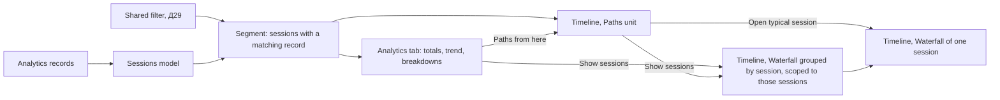
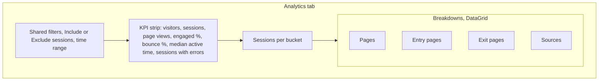
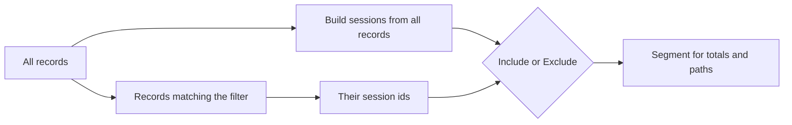
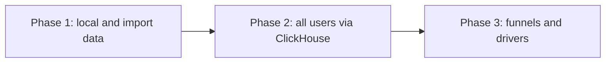

# R26 — Analyst view: totals and the average path (А2, А24, Д15, Д29, Д31)

- Date: 2026-10-16. Single pass, one model, with a headless prototype. Not a debate.
- Owner input (2026-10-16): the analyst checks data only from `connectWebAnalytics`. The admin **needs** total (average) analytics over all users' sessions. Ideal: tweaks of the Timeline, because unification is a core Reatom idea; otherwise a new "Analytics" screen. The owner's guess: a separate screen for all data, plus an average user path in the Timeline. "Maybe you can figure out something else."
- Question: which surfaces, data units and definitions give an analyst totals, breakdowns and an average path, while keeping one filter language, one Gantt and one frame card?
- Fallback: until phase 1 ships, totals come from the R24 SQL snippets and single sessions from the Records Timeline.
- Prototype: [`analytics.ts`](../../../admin/src/otlp/analytics.ts) and [`analytics.test.ts`](../../../admin/src/otlp/analytics.test.ts), 14 tests, including a round trip from the real `connectWebAnalytics` through admin ingest.

Two earlier agent passes (Timeline-only, then a revision for totals) proposed a totals strip, a Sessions mode, an Analytics screen and ClickHouse `GROUP BY`. Neither defined the average path. This note replaces both.

## Recommendation in short

1. **Timeline gets a third unit, Paths**, next to Waterfall and Log. The same `reatomGantt` draws a tree of page sequences merged across sessions (LifeFlow [1][2]). The most common path opens expanded: this is the "average user path". Bars sit at the median time since the alignment point, so the Timeline keeps a time axis. Any page can be the alignment point (GA4 backwards paths [5], Mixpanel anchors [9]).
2. **A fixed Analytics tab** for totals: a KPI strip, a sessions trend, and four breakdown tables (pages, entry pages, exit pages, sources). Clicking a row adds a filter (Plausible [14]). Every number drills down to Paths aligned at that page, or to the sessions behind it, and from there to one session in Waterfall.
3. **Filters select whole sessions** in both analyst surfaces. A session is in the segment when any of its records matches. Exclude flips it, which answers drop-off questions. Sessions are always built from all their records, so a filter never cuts a session.
4. **All users' data comes from ClickHouse.** Totals are exact SQL aggregates over a time range. Paths are built in the browser from a bounded session sample, and the status words show the sample size. Live and imported sources use the same browser model.
5. **No synthetic average session.** No real session looks like a mean, and averages over mixed groups mislead (Agency G in [2]). The admin shows medians, shares and a **typical session**: a real one that followed the most common path in the median time.



## 1. Analyst questions and where they are answered

Shneiderman's mantra: overview first, zoom and filter, then details on demand [3]. The admin already does the last two for records. The analyst needs the overview.

| Question                                                 | Surface                                                 | Prototype                                        |
| -------------------------------------------------------- | ------------------------------------------------------- | ------------------------------------------------ |
| Visitors, sessions, page views, engagement, bounce, time | Analytics tab, KPI strip                                | `analyticsTotals`                                |
| Top pages, entry and exit pages, sources                 | Analytics tab, tables                                   | `analyticsBreakdown`                             |
| What does a typical user do                              | Paths, most common path expanded                        | `analyticsPathTree`, `typicalAnalyticsPath`      |
| How do people reach `/cart`, where do they go after      | Paths aligned at `/cart`                                | `analyticsPathTree({ align })`                   |
| Where do they drop off                                   | Paths: exit here and continue per step; segment Exclude | node `stops`, `continuation`; `analyticsSegment` |
| How long from landing to cart                            | Paths bars                                              | node `offsetMs`, `durationMs`                    |
| Do errors change the path                                | Paths: sessions with errors per step                    | node `sessionsWithErrors`                        |
| What did one real user do                                | Typical session, or a session from a step               | `typicalAnalyticsSession`                        |

## 2. External references and what each gives the design

Verified on 2026-10-16. Numbers match the Sources list.

- **LifeFlow** [1] aggregates event sequences into a tree. Bar height is proportional to the number of records; the horizontal gap is the mean time between events, and the median can be selected. Any event type can be the alignment point. The authors also compared datasets side by side; the admin does not (Д27).
- **Wongsuphasawat's dissertation** [2], the Agency G case: the average clearance time across all incident types made Agency G look slowest; grouped by type, it was fast for most incidents. Lesson: segment before averaging, and do not ship a single "average session".
- **Shneiderman** [3]: overview first, zoom and filter, details on demand.
- **GA4 Path exploration** [5]: start from a starting point or an ending point; backwards pathing shows how users got to a page. **GA4 Funnel exploration** [6]: open and closed funnels, "Show elapsed time" between steps, "Next action" per step. A funnel API exists [7].
- **Amplitude Journeys** [8]: Pathfinder and Journey Map; paths by unique users or by totals; include and exclude events.
- **Mixpanel Flows** [9]: top paths between events, multiple anchor steps.
- **PostHog Paths** [10]: path cleaning rules use regex to replace dynamic URL segments with an alias, reducing cardinality. **Correlation analysis** [11] highlights events and properties that change conversion ("1.3x more likely"), warns about small samples, and saves Completed or Dropoff users as a cohort. Funnels [12].
- **Umami Journey** [13]: the most common paths from start to drop-off. Funnel report exists.
- **Plausible** [14]: any metric clicked on the dashboard becomes a filter. Funnels [15] define steps and show drop-off; flexible funnels shipped on 2026-09-23 [16].
- **Datadog funnels** [17]: conversion counted per unique `@session.id`; average time to convert; clicking a step opens a side panel with conversion drivers, journeys and replays; compare by breakdown, segment or time.
- **Grafana Traces Drilldown** [18]: tabs Breakdown, Comparison, Service structure, root-cause errors and latency. Structure is an aggregate tree over many traces, the closest observability precedent for Paths.
- **Honeycomb BubbleUp** [19]: select a region of a heatmap and compare it with the rest. Precedent for "what is different about sessions that exit here", which is selection against baseline, not side-by-side trace compare.
- **Disco (Fluxicon)** [20][21][22][23]: shows median and mean case duration; variants are distinct activity sequences sorted by frequency; maps are simplified by hiding rare paths.
- **ClickHouse** [24][25]: `windowFunnel` finds event chains in a sliding window; `sequenceMatch` matches a pattern; `arrayCompact` removes consecutive duplicates, which is how reloads collapse in SQL.

## 3. Data facts and gaps

Facts, verified in code and by the round-trip test:

- Events: `session.start`, `app.page_view`, `app.page.engagement`, `exception` (type only by default), `exception.suppressed`. All carry `session.id`, `app.visitor.id`, `app.analytics.consent`. Nothing is sent before consent, and granting consent starts a new session, so every number means "consented sessions".
- `app.page_view` has `url.path`, `url.full`, last-touch `app.utm.*` and `app.click_id.*`. `session.start` has `session.previous_id` and `app.attribution.first|last.*`.
- Engagement has only `app.engagement.visible_ms` and `active_ms`. It is flushed on hide and on navigation. The navigation flush runs before the next page view and shares its millisecond. The first view after consent is followed by a `consent` flush for that same view. Rule: engagement belongs to the last page view strictly before it, else to the first view.
- `exception.suppressed` is flushed the same way, and `app.exception.count` is sent plus dropped, so it already includes the recorded errors of that type.
- Analytics logs are public, so trace sampling does not hold them. Losses come only from rate limits: 60 per minute per event name per page, errors 10 per minute per signature.
- From ClickHouse every attribute is a string; numbers must be coerced.
- R9 definitions: engaged session is active time over 10 s, or at least 2 page views, or a conversion. Bounce is not engaged.

Gaps, not fixed:

- **G1.** Spec 03 says every analytics record has `url.path`; the code adds it only to page views. Proposal: add it to engagement and errors, keep the time rule for old data.
- **G2.** Spec 05 plans title, referrer, viewport and display on page views; none are sent. Sessions without UTM all fall into "(none)". Proposal: referrer reduced to origin, and the page title.
- **G3.** The `page_view <path>` root span is tagged `reatom.kind=action`; spec 05 reserves `page_view`, and admin `FRAMEWORK_KINDS` already handles it. One line in `emitConsentedPageView`.
- **G4.** The calculator's `session:` reads `resource['service.instance.id']` before `attributes['session.id']`, so it never matches an analytics session.
- **G5.** Frame card Overview shows only state, payload and params; analytics records look empty. Proposal: show event attributes for `app.*` and `session.*` logs. This amends a DESIGN.md product boundary.
- **G6.** The ClickHouse adapter reads the latest 500 rows per signal with no time range. A view over all users needs time-range queries and SQL aggregates (04 already lists "by time range plus filters").

## 4. Options

| Option                                      | Pros                                                                                                              | Cons                                                                      |
| ------------------------------------------- | ----------------------------------------------------------------------------------------------------------------- | ------------------------------------------------------------------------- |
| **A.** Records only, plus filters           | Nothing to build                                                                                                  | No totals; fails the owner's requirement                                  |
| **B.** Totals strip in the Timeline toolbar | Cheap                                                                                                             | Breaks "one primary surface" and "counters not duplicated"; no breakdowns |
| **C.** Paths unit in the Timeline           | The average path where the owner wants it; reuses Gantt, filters, card; LifeFlow and Grafana Structure precedents | Needs generic Gantt changes; aggregate bars can be misread as spans       |
| **D.** Fixed Analytics tab                  | Totals and breakdowns in one place; Plausible-level scope                                                         | A new view; risk of BI creep (А2)                                         |
| **E.** Funnel builder                       | Strong for conversion                                                                                             | Step-definition UI; mostly covered by Paths plus Exclude                  |
| **F.** Sankey or flow chart                 | Familiar from Mixpanel, Amplitude, Umami                                                                          | New visualization outside the kit; loses time                             |
| **G.** Grafana or SQL dashboards (R24)      | No admin work                                                                                                     | Not in the admin; the owner asked for it there                            |
| **H.** Synthetic average session            | Looks simple                                                                                                      | Misleads (Agency G); no real session matches                              |

**Pick C plus D**, with session segments; E in phase 3. Paths is a mode, not a "group by" (Д15), because the axis changes from wall clock to time since alignment, and a mode switch makes that explicit.

## 5. The average path, defined

- **Tree:** a prefix tree of page sequences per session. Root is "All sessions", or the alignment page.
- **Most common path:** from the root, follow the child with the most sessions, in both directions. Show shares at each step, so "8% reach checkout" stays honest.
- **Timing:** per node, median of the time from the alignment point to the step, and median time on the step. Computed over that node's own sessions, not by summing per-edge averages, because a child's sessions are a subset of its parent's. Medians over means, as Disco shows both [20].
- **Cleaning:** id-like segments become `:id` [10]; consecutive repeats (reloads) collapse [25]; rare siblings fold into "+N more", but a single extra sibling stays.
- **Typical session:** a real session that followed the whole most common path, with the median duration.

Most common path in the prototype fixture, seconds since the first page view:

```mermaid
gantt
  title Most common path, median times
  dateFormat X
  axisFormat %s
  section Root
  All sessions 8 : 0, 52
  section Path
  / 6 of 8 : 0, 8
  /goods/id 4 of 6 : 10, 28
  /cart 3 of 4 : 30, 40
  /checkout 1 of 3 : 40, 45
```



Aligned at `/cart`, the step before it (`/goods/:id`) has a median offset of −25 s and a median duration of 25 s, so its bar ends exactly where `/cart` starts.

## 6. UI plan

### Timeline, Paths unit

- Mode group: Waterfall, Log, Paths. Ghost buttons with `pressed`, like the existing pair.
- Columns: Sessions with a share bar, Continue %, Exit here, median time on step, Errors.
- Bars: median offset to median offset plus median time on step. Visually distinct from span bars. p25–p75 whiskers in phase 3.
- Default: the most common path expanded; other branches collapsed; "+N more" rows.
- Align control: "Align at: Session start" or any page; also a row action "Align here".
- Status words: "Paths over 1,240 of 8,302 sessions, aligned at /cart, 812 without /cart left out".
- Step card instead of the record card: sessions, share, continue and exit, timing, errors; actions "Show sessions", "Open typical session", "Align here".

### Analytics tab



- Tabs entry next to Timeline, State, Graph, Settings (DESIGN.md rule 4).
- Row click adds a filter; row actions "Paths from here" and "Show sessions".
- Fixed set, no custom dashboards; the status words name the source and say "consented sessions only".

### Records tweaks

- Fix G4 and G5.
- Waterfall grouped by session (Д15): one row per session, page views inside.
- A removable session-scope chip when opened from Paths or Analytics: "Sessions: 37 that exit at /cart".

### Segment semantics



`NOT attr.url.path=/cart` matches almost every session, because `session.start` has no `url.path`. So the session level gets an explicit Include or Exclude switch.

## 7. Data source and scale

- Live in-page source: one browser, useful for instrumentation QA. Import: whatever the file holds.
- ClickHouse: time-range picker; totals in SQL; paths from a deterministic sample, for example up to 5,000 sessions by `cityHash64(session.id)`; "sample" and "filtered locally" badges.

SQL sketches, not run against the e2e ClickHouse:

```sql
SELECT
  uniqExact(LogAttributes['app.visitor.id']) AS visitors,
  uniqExact(LogAttributes['session.id']) AS sessions,
  countIf(LogAttributes['event.name'] = 'app.page_view') AS page_views
FROM otel_logs
WHERE Timestamp >= {from:DateTime64(9)} AND Timestamp < {to:DateTime64(9)}
```

```sql
SELECT
  count() AS sessions,
  countIf(views >= 2 OR active_ms > 10000) AS engaged_sessions,
  quantileExact(0.5)(active_ms) AS median_active_ms
FROM (
  SELECT
    LogAttributes['session.id'] AS session_id,
    countIf(LogAttributes['event.name'] = 'app.page_view') AS views,
    sumIf(
      toUInt64OrZero(LogAttributes['app.engagement.active_ms']),
      LogAttributes['event.name'] = 'app.page.engagement'
    ) AS active_ms
  FROM otel_logs
  WHERE Timestamp >= {from:DateTime64(9)} AND Timestamp < {to:DateTime64(9)}
  GROUP BY session_id
)
```

```sql
SELECT path, count() AS sessions
FROM (
  SELECT
    LogAttributes['session.id'] AS session_id,
    arrayCompact(arrayMap(x -> x.2, arraySort(x -> x.1,
      groupArray((Timestamp, LogAttributes['url.path']))))) AS path
  FROM otel_logs
  WHERE LogAttributes['event.name'] = 'app.page_view'
    AND Timestamp >= {from:DateTime64(9)} AND Timestamp < {to:DateTime64(9)}
  GROUP BY session_id
)
GROUP BY path
ORDER BY sessions DESC
LIMIT 50
```

```sql
SELECT level, count() AS sessions
FROM (
  SELECT
    LogAttributes['session.id'] AS session_id,
    windowFunnel(1800)(
      toDateTime(Timestamp),
      LogAttributes['url.path'] = '/',
      LogAttributes['url.path'] = '/cart',
      LogAttributes['url.path'] = '/checkout'
    ) AS level
  FROM otel_logs
  WHERE LogAttributes['event.name'] = 'app.page_view'
    AND Timestamp >= {from:DateTime64(9)} AND Timestamp < {to:DateTime64(9)}
  GROUP BY session_id
)
GROUP BY level
ORDER BY level
```

## 8. MCP parity (О1, Д34)

- `admin.analyticsSummary({ filter, range })`: totals and top breakdown rows, capped at 20 KB.
- `admin.paths({ filter, align, depth, maxChildren })`: summarized path nodes with a cursor.
- Both take the calculator filter with session semantics.

## 9. Generic changes for unification

- `reatomGantt`: an `order` comparator for siblings (paths sort by frequency, records by start); expansion and selection keyed by `id`, because aggregate nodes are rebuilt on every filter change and the current `Set<Node>` loses them.
- `GanttChart.tsx`: a row adapter, since it is typed to `AdminRecord`. DESIGN.md "GanttChart stays typed to the admin record" is amended.

## 10. Spec and producer changes

- Producer: G1, G2, G3.
- Admin: G4, G5, G6.
- README "Analytics scope": add that the admin has fixed analyst views (totals, breakdowns, paths) over the same records; custom dashboards stay deferred (А2, owner 2026-10-16).
- 04 Views: add the Paths unit and the Analytics tab; R19 (Д31) is partly answered by this note.
- Never list unchanged: no side-by-side trace compare (Д27), no time travel (Д19).

## 11. Phased plan



1. **Phase 1, admin only.** Move the prototype into atoms in the admin model. Analytics tab with KPI strip, four tables, click-to-filter, Include and Exclude. Paths unit with step card, align, typical session. Gantt `order` and id-keyed state. G4, G5. Storybook journeys and MCP tools.
2. **Phase 2.** ClickHouse time range, SQL totals, sampled sessions for paths, badges. Producer fixes G1–G3 and spec 05 updates.
3. **Phase 3.** Funnels on `windowFunnel` with a step side panel (Datadog [17]). p25–p75 whiskers. "What is different here" for a step: its sessions' sources, devices and errors against all sessions (BubbleUp [19], PostHog correlation [11]).

## 12. Risks

- Medians read as real times: label them "median" and keep the typical-session link.
- Small samples: show counts beside every share; hide shares under a minimum count.
- Rate limits drop events, so some paths miss steps; show drops when the source exposes them.
- All-users data needs ClickHouse credentials, held in memory only (Д43).

## Sources

1. LifeFlow project page, with the CHI'11 paper "LifeFlow: Visualizing an Overview of Event Sequences", pp. 1747–1756: https://www.cs.umd.edu/hcil/lifeflow/ — DOI https://doi.org/10.1145/1978942.1979196
2. K. Wongsuphasawat, "Interactive Exploration of Temporal Event Sequences", dissertation, 2012: https://hdl.handle.net/1903/12749
3. B. Shneiderman, "The Eyes Have It", 1996: https://www.cs.umd.edu/~ben/papers/Shneiderman1996eyes.pdf
4. R9 definitions of engaged session and bounce: [R9-engagement.md](R9-engagement.md)
5. GA4 Path exploration: https://support.google.com/analytics/answer/9317498
6. GA4 Funnel exploration: https://support.google.com/analytics/answer/9327974
7. GA4 Data API `runFunnelReport`: https://developers.google.com/analytics/devguides/reporting/data/v1/rest/v1alpha/properties/runFunnelReport
8. Amplitude Journeys: https://amplitude.com/docs/analytics/charts/journeys/journeys-understand-paths
9. Mixpanel Flows: https://docs.mixpanel.com/docs/reports/flows
10. PostHog Paths and path cleaning: https://posthog.com/docs/product-analytics/paths
11. PostHog correlation analysis: https://posthog.com/docs/product-analytics/correlation
12. PostHog funnels: https://posthog.com/docs/product-analytics/funnels
13. Umami Journey: https://docs.umami.is/docs/journey — Funnel: https://docs.umami.is/docs/funnel
14. Plausible filters: https://plausible.io/docs/filters-segments
15. Plausible funnel analysis: https://plausible.io/docs/funnel-analysis
16. Plausible changelog, flexible funnels: https://plausible.io/changelog
17. Datadog funnel analysis: https://docs.datadoghq.com/product_analytics/charts/funnel_analysis/
18. Grafana Traces Drilldown, analyze tracing data: https://grafana.com/docs/grafana/latest/visualizations/simplified-exploration/traces/investigate/analyze-tracing-data/
19. Honeycomb BubbleUp: https://docs.honeycomb.io/investigate/analyze/identify-outliers/
20. Disco statistics view: https://fluxicon.com/book/read/statisticsview/
21. Disco cases view, variants: https://fluxicon.com/book/read/casesview/
22. Disco map view: https://fluxicon.com/book/read/mapview/
23. Disco simplification: https://fluxicon.com/book/read/simplification/
24. ClickHouse parametric aggregate functions (`windowFunnel`, `sequenceMatch`): https://clickhouse.com/docs/reference/functions/aggregate-functions/parametric-functions
25. ClickHouse array functions (`arrayCompact`): https://clickhouse.com/docs/reference/functions/regular-functions/array-functions

## Status

Phase 1 shipped in `@reatom/admin` on 2026-10-16 ([AD-14](../../../admin/workflow/backlog.yaml)): the Paths unit, the Analytics tab, session segments, Gantt `key` and `order`, G4, G5, and the `analyticsSummary` and `paths` MCP tools.

Two deviations from this note:

- Clicking a breakdown row sets a removable session-scope chip. It does not add a calculator target. A `page:` target is an AD-15 follow-up.
- Show sessions scopes the record Waterfall to those sessions. Grouping the Waterfall by session (Д15) is deferred to AD-15.

Phase 2 is AD-15: ClickHouse range, SQL totals, sampled paths, badges, and grouped-by-session waterfall, including G6. Producer gaps G1–G3 are WA-11–WA-13. Phase 3 is AD-16: funnels, whiskers, and step drivers.
